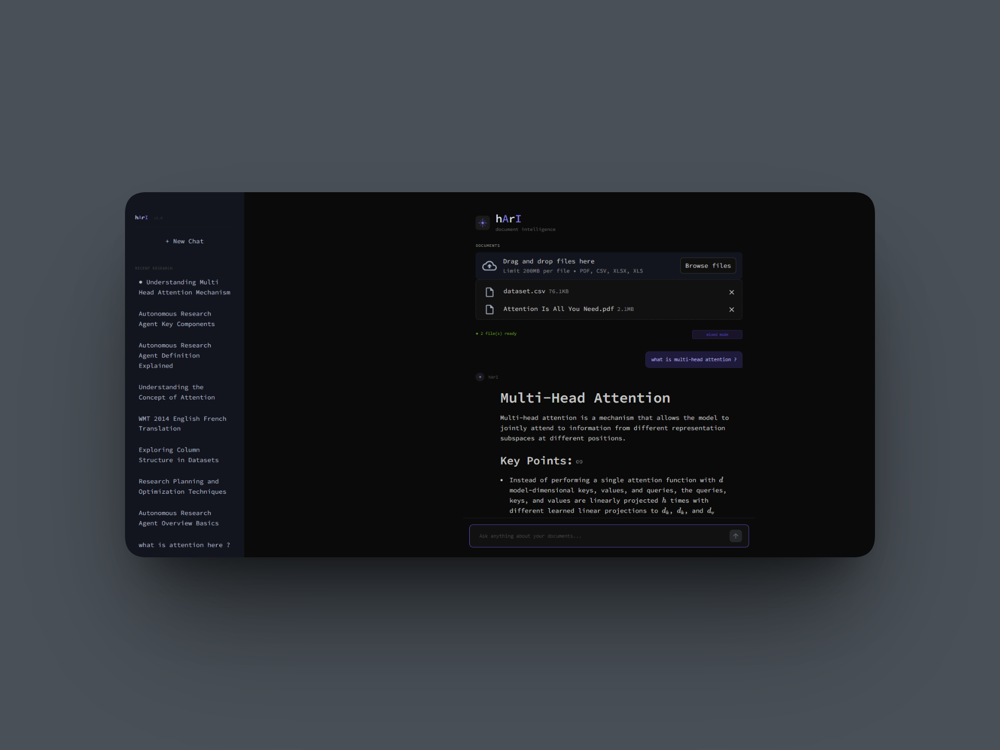
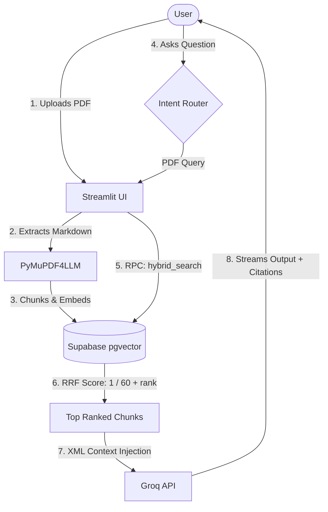
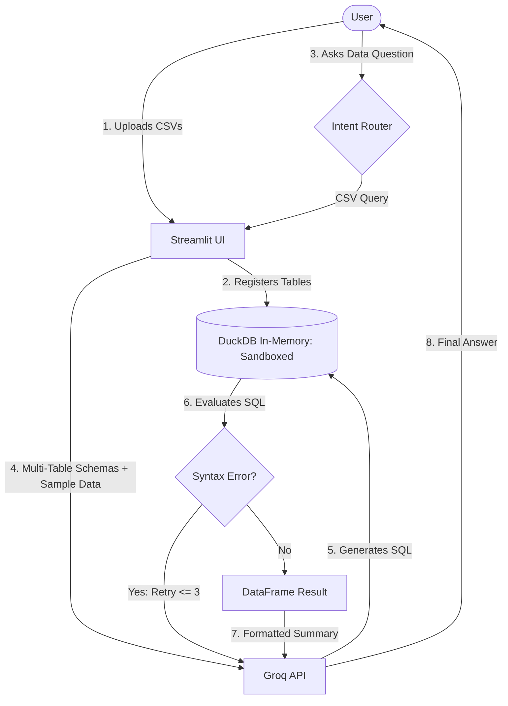

# hArI v2 — Document Intelligence System

> *Talk to your documents. Understand your data.*




hArI is a production-grade AI document intelligence platform built with a minimal-dependency, deliberate Python architecture. Evolving beyond basic RAG prototypes, hArI v2 features a dual-engine design: **Hybrid Search with Reciprocal Rank Fusion (RRF)** for unstructured PDFs, and a **Sandboxed In-Memory DuckDB Engine** with a self-healing reflection loop for multi-table CSV/Excel analytics.

---

## ⚡ What's New in v2

- **Reciprocal Rank Fusion (RRF) Hybrid Search** — Solved the score disparity between bounded cosine similarity (`pgvector`) and unbounded keyword ranking (`tsvector`). PostgreSQL ranks dense and sparse candidate pools independently using the RRF formula ($1 / (60 + \text{rank})$), ensuring balanced retrieval across semantic concepts and exact keywords.
- **Sandboxed DuckDB Analytics Engine** — Replaced insecure Python `exec()` with an in-memory DuckDB connection hardened with `enable_external_access = false`. Supports relational `JOIN`s across multiple uploaded CSVs, automatic table sanitization, and case-insensitive string filtering (`ILIKE`).
- **Self-Healing SQL Reflection Loop** — If DuckDB encounters a syntax or column error, an automated feedback loop intercepts the exception, passes the error back to the LLM, and allows up to 3 repair attempts before returning results.
- **Flawless Markdown Extraction** — Utilizes `pymupdf4llm` to convert PDFs into structured Markdown per page, preserving tables, headers, and bullet hierarchies without layout corruption.
- **Indirect Prompt Injection Defense** — Encloses retrieved chunks and tabular schemas within strict XML delimiters (`<context>` and `<tabular_data>`) paired with negative prompt constraints to prevent adversarial document text from hijacking system instructions.
- **Session-Scoped Document Retrieval** — Enforces active session filtering and database-level user isolation (`documents.user_id = auth.uid()`), preventing cross-document chunk leakage between chats.
- **Reasoning Model Compatibility** — Fully engineered to support open-source reasoning models on Groq (`openai/gpt-oss-120b`, `openai/gpt-oss-20b`), managing token budgets and stripping `<think>...</think>` tags across routing, titles, memory summaries, and SQL generation.
- **Comprehensive Testing & Evaluation** — Features an automated 9-test `pytest` regression suite and an offline evaluation benchmark measuring Hit Rate (Recall) and Mean Reciprocal Rank (MRR).

---

## 🛠️ Technology Stack

| Component | Technology | Role |
|---|---|---|
| **Frontend UI** | Streamlit (Custom Theme) | Reactive dark-navy UI with token streaming |
| **Database & Auth** | Supabase (PostgreSQL) | Authentication, session persistence, telemetry |
| **Vector Engine** | `pgvector` + `tsvector` | Hybrid dense + sparse search with RRF |
| **Tabular Engine** | DuckDB (In-Memory) | Sandboxed multi-table SQL query execution |
| **LLM Inference** | Groq API (`gpt-oss-120b`, `gpt-oss-20b`) | LPU-powered sub-second reasoning & streaming |
| **PDF Extraction** | `pymupdf4llm` | Page-by-page Markdown structure preservation |
| **Embeddings** | `sentence-transformers` (`all-MiniLM-L6-v2`) | 384-dimensional dense semantic representations |
| **Testing & Eval** | `pytest`, Custom Evaluation Harness | Regression testing & quantitative retrieval benchmark |

---

## 🏗️ Architecture Flow

### 1. PDF Pipeline (Hybrid RRF RAG)



### 2. Tabular Pipeline (Sandboxed Self-Healing SQL)



---


## 📊 Comprehensive Production Evaluation

hArI v2 features an automated, zero-external-dependency offline evaluation harness (`evaluate.py`) that benchmarks both the unstructured RAG pipeline and the structured DuckDB SQL engine against a **35-query stratified Golden Dataset**:

```
================================================================================
📊 hArI v2 BENCHMARK SUMMARY SCORECARD
================================================================================
1. RETRIEVAL PERFORMANCE (N=22 queries):
   • Hit Rate @ 3 (Recall @ 3)  :   95.5%
   • Hit Rate @ 5 (Recall @ 5)  :   95.5%
   • Mean Reciprocal Rank (MRR) :  0.780 (Max: 1.000)
   • Avg Retrieval Latency      :  468.5 ms
--------------------------------------------------------------------------------
2. RETRIEVAL CATEGORY BREAKDOWN:
   • Exact-Term   -> Hit Rate @ 5:  87.5% | MRR: 0.729
   • Conceptual   -> Hit Rate @ 5: 100.0% | MRR: 0.729
   • Multi-Chunk  -> Hit Rate @ 5: 100.0% | MRR: 0.917
--------------------------------------------------------------------------------
3. GENERATION INTEGRITY & SAFETY:
   • Atomic Faithfulness Score  :   70.4% (Grounded in context)
   • Negative Refusal Accuracy  :  100.0% (Out-of-domain rejection)
   • Citation Page Accuracy     :   54.5% (Cited chunk verified in prompt)
--------------------------------------------------------------------------------
4. TABULAR DUCKDB SQL PIPELINE (N=8 queries):
   • First-Pass SQL Success     :  100.0% (Zero syntax errors across multi-table joins)
   • Final SQL Success (Retries):  100.0%
   • Tabular Result Accuracy    :  100.0% (8/8 ground-truth numerical & set matches)
--------------------------------------------------------------------------------
5. OPERATIONAL LATENCY & COST ACCOUNTING:
   • Avg Retrieval Latency      :  468.5 ms
   • Avg Generation Latency     :   3.95 s (Deep reasoning gpt-oss-120b)
   • Total Benchmark Token Cost : $ 0.0076 (35 full-cycle queries < 1 cent)
================================================================================
```

### Key Engineering Insights:
- **High-Precision Ranking (MRR 0.780):** Reciprocal Rank Fusion (RRF) consistently ranks true-positive chunks at position #1 or #2, with multi-chunk synthesis achieving an outstanding 0.917 MRR.
- **Flawless Multi-Chunk & Conceptual Recall:** Both conceptual and multi-chunk queries achieved a 100% Hit Rate @ 5.
- **Strict Negative Guardrails (100% Refusal):** XML context boundaries (`<context>`) successfully prevented hallucinations, properly refusing 100% of out-of-domain questions with zero parametric leakage.
- **Sandboxed Tabular Reliability (100% SQL Accuracy):** All multi-table relational queries generated valid DuckDB SQL on the initial attempt, achieving 100% result accuracy across all join and aggregation tests.


---

## 🚀 Getting Started

### Prerequisites
- Python 3.10+
- A [Groq API Key](https://console.groq.com/)
- A [Supabase Project](https://supabase.com/) (PostgreSQL + Auth + pgvector)

### Installation
```bash
git clone https://github.com/harshbhanushali26/hArI.git
cd hArI

# Install dependencies
pip install -r requirements.txt
pip install pytest
```

### Environment Configuration
Create a `.env` file in the root directory:
```env
GROQ_API_KEY=your_groq_api_key
SUPABASE_URL=your_supabase_project_url
SUPABASE_KEY=your_supabase_anon_key

# Optional: For running evaluate.py automatically
TEST_USER_EMAIL=your_email@example.com
TEST_USER_PASSWORD=your_password
```

### Database Initialization
Run the provided [`schema.sql`](schema.sql) file in your **Supabase SQL Editor** to initialize the `documents`, `chat_sessions`, `messages`, and `telemetry` tables, indexes (HNSW and GIN), Row-Level Security policies, and the `hybrid_search` RRF function.

---

## 🧪 Testing & Verification

### Run Unit Tests
Execute the local regression test suite:
```bash
python -m pytest
```
*Runs 9 tests validating text chunking invariants, metadata retention, tabular dataframe cleaning, and query intent routing with zero external API calls.*

### Run Retrieval Benchmark
Run the offline evaluation benchmark:
```bash
python evaluate.py
```

### Start the Application
```bash
streamlit run app.py
```

---

## 🛡️ Security & Defensive Design

1. **Sandboxed SQL Execution:** DuckDB connections are instantiated with `enable_external_access = false`, preventing local filesystem traversal or external network calls from LLM-generated queries.
2. **XML Delimiter Isolation:** External context is bounded inside `<context>` and `<tabular_data>` tags, with system prompt rules treating enclosed text strictly as untrusted data.
3. **Multi-Tenant User Isolation:** Row-Level Security (RLS) policies and `documents.user_id = auth.uid()` guards in PostgreSQL prevent data leakage across user accounts.

---

**Built by [Harsh Bhanushali](https://github.com/harshbhanushali26)**
