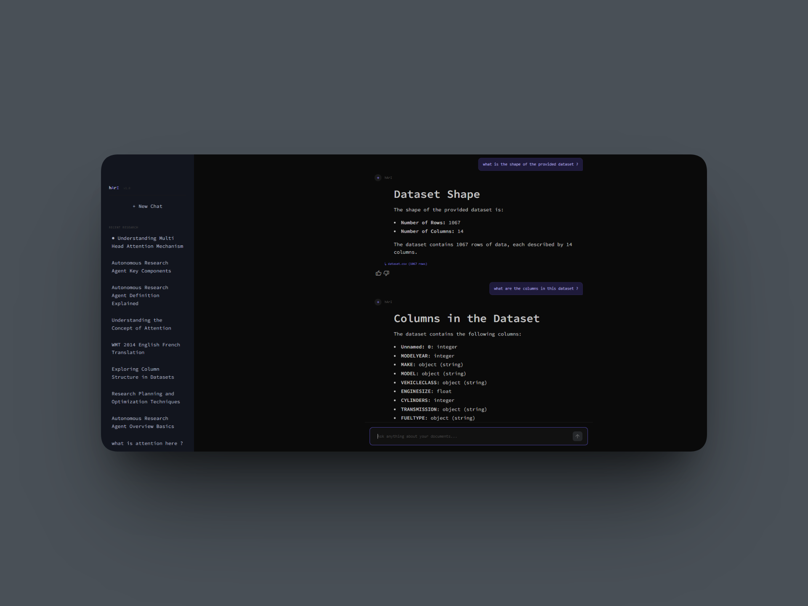

# hArI v2 — Document Intelligence System

> *Talk to your documents. Understand your data.*




hArI is a production-grade AI document intelligence platform built with a minimal-dependency, deliberate Python architecture. Evolving beyond basic RAG prototypes, hArI v2 features a dual-engine design: **Hybrid Search with Reciprocal Rank Fusion (RRF)** for unstructured PDFs, and a **Sandboxed In-Memory DuckDB Engine** with a self-healing reflection loop for multi-table CSV/Excel analytics.

---

## ⚡ What's New in v2

- **Reciprocal Rank Fusion (RRF) Hybrid Search** — Solved the score disparity between bounded cosine similarity (`pgvector`) and unbounded keyword ranking (`tsvector`). PostgreSQL ranks dense and sparse candidate pools independently using the RRF formula ($1 / (60 + \text{rank})$), ensuring balanced retrieval across semantic concepts and exact keywords.
- **Sandboxed DuckDB Analytics Engine** — Replaced insecure Python `exec()` with an in-memory DuckDB connection hardened with `enable_external_access = false`. Supports relational `JOIN`s across multiple uploaded CSVs, automatic table sanitization, and case-insensitive string filtering (`ILIKE`).
- **Self-Healing SQL Reflection Loop** — If DuckDB encounters a syntax or column error, an automated feedback loop intercepts the exception, passes the error back to the LLM, and allows up to 3 repair attempts before returning results.
- **Flawless Markdown Extraction** — Utilizes `pymupdf4llm` to convert PDFs into structured Markdown per page, preserving tables, headers, and bullet hierarchies without layout corruption.
- **Indirect Prompt Injection Defense** — Encloses retrieved chunks and tabular schemas within strict XML delimiters (`<context>` and `<tabular_data>`) paired with negative prompt constraints to prevent adversarial document text from hijacking system instructions.
- **Session-Scoped Document Retrieval** — Enforces active session filtering and database-level user isolation (`documents.user_id = auth.uid()`), preventing cross-document chunk leakage between chats.
- **Reasoning Model Compatibility** — Fully engineered to support open-source reasoning models on Groq (`openai/gpt-oss-120b`, `openai/gpt-oss-20b`), managing token budgets and stripping `<think>...</think>` tags across routing, titles, memory summaries, and SQL generation.
- **Comprehensive Testing & Evaluation** — Features an automated 9-test `pytest` regression suite and an offline evaluation benchmark measuring Hit Rate (Recall) and Mean Reciprocal Rank (MRR).

---

## 🛠️ Technology Stack

| Component | Technology | Role |
|---|---|---|
| **Frontend UI** | Streamlit (Custom Theme) | Reactive dark-navy UI with token streaming |
| **Database & Auth** | Supabase (PostgreSQL) | Authentication, session persistence, telemetry |
| **Vector Engine** | `pgvector` + `tsvector` | Hybrid dense + sparse search with RRF |
| **Tabular Engine** | DuckDB (In-Memory) | Sandboxed multi-table SQL query execution |
| **LLM Inference** | Groq API (`gpt-oss-120b`, `gpt-oss-20b`) | LPU-powered sub-second reasoning & streaming |
| **PDF Extraction** | `pymupdf4llm` | Page-by-page Markdown structure preservation |
| **Embeddings** | `sentence-transformers` (`all-MiniLM-L6-v2`) | 384-dimensional dense semantic representations |
| **Testing & Eval** | `pytest`, Custom Evaluation Harness | Regression testing & quantitative retrieval benchmark |

---

## 🏗️ Architecture Flow

### 1. PDF Pipeline (Hybrid RRF RAG)


### 2. Tabular Pipeline (Sandboxed Self-Healing SQL)


---

## 📊 Offline Retrieval Evaluation

hArI includes an automated offline evaluation script (`evaluate.py`) that benchmarks hybrid retrieval against a stratified 20-query Golden Dataset across varying difficulty levels:

```
========================================================================
📊 BENCHMARK SUMMARY SCORECARD
========================================================================
Overall Hit Rate @ 3 (Recall @ 3) :   95.0%
Overall Hit Rate @ 5 (Recall @ 5) :   95.0%
Overall Mean Reciprocal Rank (MRR):  0.783 (Max: 1.000)
Average Retrieval Latency         :  218.0 ms
------------------------------------------------------------------------
DIFFICULTY BREAKDOWN:
  • Easy   (5 queries) -> Hit Rate @ 5:  80.0% | MRR: 0.700
  • Medium (8 queries) -> Hit Rate @ 5: 100.0% | MRR: 0.771
  • Hard   (7 queries) -> Hit Rate @ 5: 100.0% | MRR: 0.857
========================================================================
```

- **Hit Rate @ 5 (Recall):** 95.0% of queries successfully surfaced the exact ground-truth chunk in the top 5 results.
- **Mean Reciprocal Rank (MRR):** 0.783 demonstrates that true-positive chunks consistently rank at position #1 or #2.
- **Latency:** ~218ms average latency for combined local embedding and Supabase cloud RPC execution.

---

## 🚀 Getting Started

### Prerequisites
- Python 3.10+
- A [Groq API Key](https://console.groq.com/)
- A [Supabase Project](https://supabase.com/) (PostgreSQL + Auth + pgvector)

### Installation
```bash
git clone https://github.com/harshbhanushali26/hArI.git
cd hArI

# Install dependencies
pip install -r requirements.txt
pip install pytest
```

### Environment Configuration
Create a `.env` file in the root directory:
```env
GROQ_API_KEY=your_groq_api_key
SUPABASE_URL=your_supabase_project_url
SUPABASE_KEY=your_supabase_anon_key

# Optional: For running evaluate.py automatically
TEST_USER_EMAIL=your_email@example.com
TEST_USER_PASSWORD=your_password
```

### Database Initialization
Run the provided [`schema.sql`](schema.sql) file in your **Supabase SQL Editor** to initialize the `documents`, `chat_sessions`, `messages`, and `telemetry` tables, indexes (HNSW and GIN), Row-Level Security policies, and the `hybrid_search` RRF function.

---

## 🧪 Testing & Verification

### Run Unit Tests
Execute the local regression test suite:
```bash
python -m pytest
```
*Runs 9 tests validating text chunking invariants, metadata retention, tabular dataframe cleaning, and query intent routing with zero external API calls.*

### Run Retrieval Benchmark
Run the offline evaluation benchmark:
```bash
python evaluate.py
```

### Start the Application
```bash
streamlit run app.py
```

---

## 🛡️ Security & Defensive Design

1. **Sandboxed SQL Execution:** DuckDB connections are instantiated with `enable_external_access = false`, preventing local filesystem traversal or external network calls from LLM-generated queries.
2. **XML Delimiter Isolation:** External context is bounded inside `<context>` and `<tabular_data>` tags, with system prompt rules treating enclosed text strictly as untrusted data.
3. **Multi-Tenant User Isolation:** Row-Level Security (RLS) policies and `documents.user_id = auth.uid()` guards in PostgreSQL prevent data leakage across user accounts.

---

**Built by [Harsh Bhanushali](https://github.com/harshbhanushali26)**
